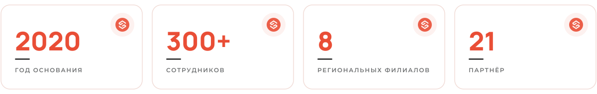
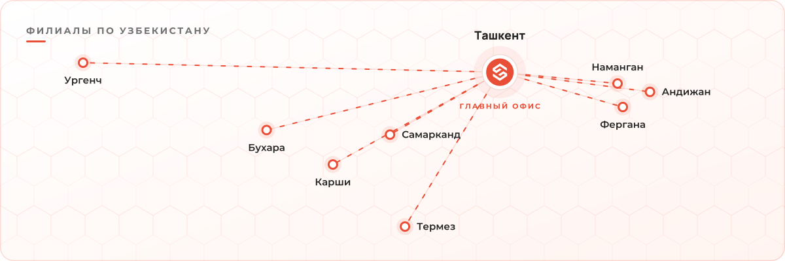
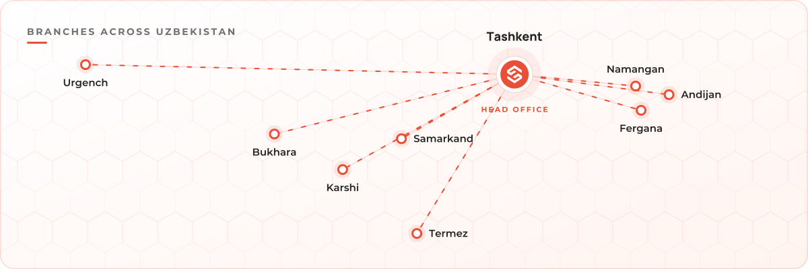
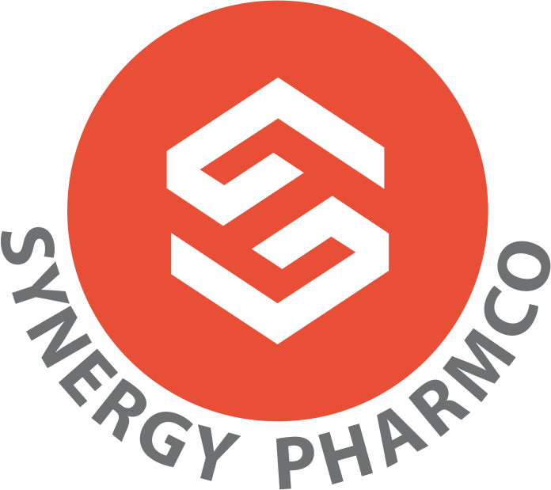

 

**🇷🇺 [Русский](#-о-компании)** &nbsp;·&nbsp; **en [English](#-about-the-company)**

 

## 💊 О компании

**SYNERGY PHARMCO** — стратегическая компания в области новейших разработок, производства и активного маркетинга лекарственных средств, биологически активных добавок, медицинских и косметических средств в Узбекистане и на зарубежных рынках.

Компания основана в 2020 году. Мы выпускаем широкий ассортимент препаратов и экспортируем их на международные рынки. Работаем с ведущими европейскими заводами, которые отвечают за качество и безопасность продукции. Наши партнёры имеют сертификаты **GMP**, **FDA** и **DSR**.

> *Сохраним здоровье вместе!*

 

 

## 🧪 Продукция

<table>
<tr>
<td width="25%" align="center" valign="top">

### Ринотин
Поддержка иммунитета

</td>
<td width="25%" align="center" valign="top">

### Радоксил
Здоровье печени и желчного пузыря

</td>
<td width="25%" align="center" valign="top">

### Эратон
Кальциево-фосфорный обмен

</td>
<td width="25%" align="center" valign="top">

### Кретамин
Профилактика и комплексная терапия

</td>
</tr>
</table>

**Формы выпуска:** твёрдые лекарственные формы · жидкие лекарственные формы · медицинские изделия

 

## 🗺 Филиалы

 

## 🤝 Партнёры

`Fulton` `Tocura` `Istem` `Pharmasade` `Herbapol` `Galenicum` `Unimed` `Monos` `Gricar` `Berko` `BIH` `Bruschettini` `AronPharma` `ARAFARMA` `Ekofarm` `Vira-pharm` `Wrocławskie` `Rad Ilac` `NEW FA.DEM` `Milsing` `Lo.Li.`

 

## 📬 Контакты

| | |
|:--|:--|
| 🌐 **Сайт** | [synergypharm.org](https://synergypharm.org) |
| ✉️ **Email** | [info@synergypharm.org](mailto:info@synergypharm.org) |
| 📞 **Телефоны** | [+998 55 520-07-37](tel:+998555200737) · [+998 88 000-56-65](tel:+998880005665) · [+998 88 101-12-29](tel:+998881011229) · [+998 97 101-38-27](tel:+998971013827) |
| 📍 **Адрес** | г. Ташкент, Яккасарайский район, ул. Имама Ат-Термизи, 35 |
| 🕘 **Режим работы** | Пн–Пт, 9:00–18:00 |

 

---

 

## 💊 About the company

**SYNERGY PHARMCO** is a pharmaceutical company focused on new drug development, production and active marketing of medicines, dietary supplements, medical devices and cosmetics in Uzbekistan and international markets.

Founded in 2020, the company produces a broad range of medicines and exports them abroad. We work with leading European manufacturing plants responsible for product quality and safety; our partners hold **GMP**, **FDA** and **DSR** certificates.

> *Let's protect health together!*

 

 

## 🧪 Products

<table>
<tr>
<td width="25%" align="center" valign="top">

### Rinotin
Immune support

</td>
<td width="25%" align="center" valign="top">

### Radoksil
Liver and gallbladder health

</td>
<td width="25%" align="center" valign="top">

### Eraton
Calcium–phosphorus metabolism

</td>
<td width="25%" align="center" valign="top">

### Kretamin
Prevention and combination therapy

</td>
</tr>
</table>

**Dosage forms:** solid dosage forms · liquid dosage forms · medical devices

 

## 🗺 Branches

 

## 📬 Contact

**SYNERGY PHARMCO** · 35 Imam At-Termizi St., Yakkasaray district, Tashkent · [synergypharm.org](https://synergypharm.org) · [info@synergypharm.org](mailto:info@synergypharm.org) · +998 55 520-07-37 · Mon–Fri 9:00–18:00

 

  
   
  © SYNERGY PHARMCO · Сохраним здоровье вместе!

